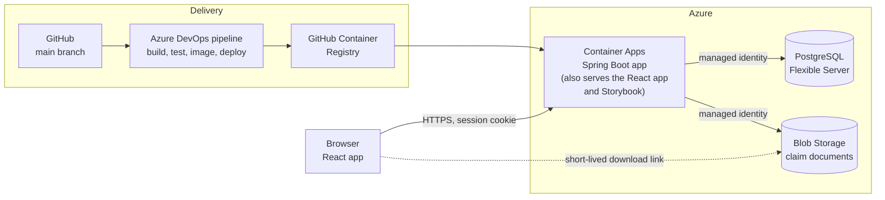
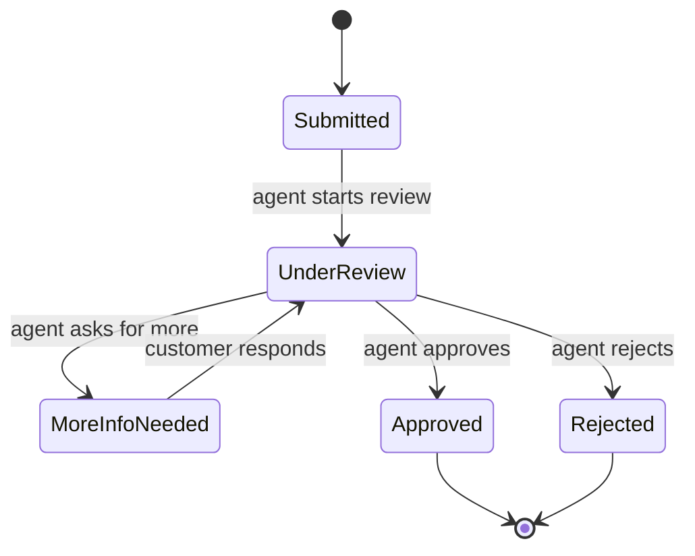

# Teduh Claims

A travel insurance claims portal. A traveller buys a plan for a trip, makes a claim with photos or PDFs of their receipts, and follows it step by step. A claims officer picks the claim up, asks for anything missing, and approves or rejects it with a reason. Both sides are notified each time the claim moves.

Teduh is a fictional insurer, made for my portfolio. Nothing is charged, no money is paid, and the demo resets itself every day.

<!-- Pipeline badge: in Azure DevOps open Pipelines, the teduh-claims pipeline, the three dots menu, Status badge, and paste the Markdown here. -->

- Live demo: https://teduh-claims.grayisland-5bebc3bc.eastasia.azurecontainerapps.io
- Component library (Storybook): https://teduh-claims.grayisland-5bebc3bc.eastasia.azurecontainerapps.io/storybook/
- API description (OpenAPI): https://teduh-claims.grayisland-5bebc3bc.eastasia.azurecontainerapps.io/v3/api-docs

The server sleeps when nobody is using it, so the first visit can take about a minute.

<!-- GIF: docs/images/demo.gif, the whole story in about 30 seconds -->

## Try it

The sign-in page has three buttons, so you never need a password:

- Try as a new customer: a fresh account with no policy. Choose a plan and trip dates, then claim.
- Try as customer Aisyah Rahman: she already has a Teduh Travel Plus policy.
- Try as agent Farid Hassan: the claims officer's queue, review page and decisions.

The full story takes about five minutes with two browser windows side by side, one as Aisyah and one as Farid:

1. Aisyah's bag arrived two days late. She claims RM 450 for clothes and toiletries and attaches two receipts.
2. Farid sees the claim in his queue, opens it and starts the review. Aisyah is notified.
3. Farid asks for the airline's delay letter. The claim moves to More info needed.
4. Aisyah's bell shows the request. She uploads the letter with a short note, and the claim goes back to Farid.
5. Farid approves RM 400 of the RM 450, because the meals had no receipts, and says why.
6. Aisyah sees Approved, the amount, the reason, and every step with who did it and when.

Use made-up files only. There are three in [`docs/usability-test-files`](docs/usability-test-files).

<!-- Screenshots, in docs/images/: customer home, the claim form's check step, the claim page after approval, the agent queue, the agent review page with the approve dialog, choose a plan. -->

## How it is built



- One Spring Boot application serves the API, the React app and the Storybook from the same address, so the session cookie and the CSRF token work without any cross-site setup.
- The app signs in to PostgreSQL and Blob Storage with its Azure managed identity. There are no database passwords or storage keys in the app or its settings.
- Documents stay in a private container. Downloading one gives a link that works for 15 minutes and only for that file.
- Every push to `main` runs the pipeline: the Java tests against real PostgreSQL and Azurite in Docker, the React tests and every Storybook story in Chromium with accessibility checks, then the image build and the deploy. A failing test stops the deploy.

### Inside the Spring Boot app

The backend is a modular monolith: one application, split into modules that may only use each other's public parts. A Spring Modulith test fails the build if one module reaches into another's internals or if two modules depend on each other in a circle.

| Module | What it owns |
| --- | --- |
| `accounts` | Sign-in, roles, sessions (kept in PostgreSQL), the demo accounts, "Try as a new customer" |
| `policies` | The three plans, buying a plan for a trip, each customer's policies and limits |
| `claims` | Claims, their state machine and history, the agent's queue and decisions |
| `documents` | Checking uploaded files and storing them in Blob Storage |
| `notifications` | The bell: one notification per status change, for the right person |
| `demo` | The daily reset that puts the public demo back to its starting state |

A claim moves through five states, and every move is checked in one place:



When a claim changes state, the claims module publishes an event and the notifications module listens for it. Spring Modulith stores the event before it is delivered, so a notification isn't lost if the app stops halfway; it is sent again when the app starts.

## Tech

- Backend: Java 25, Spring Boot 4.1, Spring Modulith 2.1, Spring Security, Spring Data JPA, Spring Session JDBC, Flyway, PostgreSQL 18, Azure Blob Storage.
- Frontend: React 19, TypeScript 7, Vite 8, React Router 8, TanStack Query, React Hook Form, CSS Modules with design tokens, lucide-react icons.
- API types: the TypeScript types are generated from the API's OpenAPI document, so a changed endpoint breaks the frontend build instead of the live site.
- Design: Figma (flows, wireframes, high-fidelity screens, variables and components) and Storybook 10 for every shared component.
- Testing: JUnit, Testcontainers with real PostgreSQL and Azurite, MockMvc, Vitest, Storybook stories run as tests with axe accessibility checks. 304 tests run on every push (143 Java, 161 web).
- Delivery: Azure DevOps Pipelines, GitHub Container Registry, Azure Container Apps.

## Security and privacy

- Roles are checked on every endpoint. A customer asking for someone else's claim gets "Claim not found", the same answer as for a claim that doesn't exist.
- Only the agent who started a review can act on that claim. If two agents change the same claim at once, the second is told the claim changed and asked to reload.
- Changes need a CSRF token. The session cookie is HTTP-only, secure and SameSite=Lax.
- Uploaded files are checked by their content, not their name: PDF, JPEG or PNG only, up to 10 MB each, five per upload.
- "Try as a new customer" asks for no name, email or password, so no real personal details reach the demo.

## Accessibility

The target is WCAG 2.2 AA: everything works with a keyboard, focus is always visible, every field has a label, a form with mistakes shows a summary at the top that links to each one, and a status is never shown by colour alone. Every Storybook story runs the axe checks as part of the test run. Screen readers hear each new step's heading when a multi-step form moves on.

## Run it locally

You need Java 25, Docker and Node 22.

Start the API with its own PostgreSQL and Azurite in Docker (Testcontainers starts them):

```
./mvnw spring-boot:test-run
```

On Windows use `mvnw.cmd spring-boot:test-run`. Then, in a second terminal, start the React app, which forwards `/api` calls to port 8080:

```
cd web
npm ci
npm run dev
```

Open http://localhost:5173 and use the demo buttons.

Run the tests (the web tests need Chromium once, for the stories):

```
./mvnw verify
cd web
npx playwright install chromium
npm test
```

`npm run storybook` opens the component library on port 6006.

## Design process and usability test

The screens were designed in Figma first: user flows for both roles, then wireframes, then high-fidelity screens with variables for colour, type and spacing that match the code's design tokens. The customer side is designed for a phone and uses Teduh green; the agent side is designed for a laptop and uses blue.

<!-- Case study link and summary: added after the usability sessions. -->

## Things the build leaves out on purpose

Some screens in the Figma design show things the app can't back up, so the build leaves them out rather than showing buttons that do nothing: payouts and payout times, an emergency hotline, Remember me and Forgot password, dispute links, and the agent dashboard's sample figures.

## What I'd do next

- Password reset and real sign-up with email verification, or move accounts to Microsoft Entra External ID or Keycloak.
- Email notifications through Azure Communication Services, next to the in-app bell.
- Disputes and a second review for rejected claims.
- Payouts, recorded against the approved amount.
- A PDF summary of a decided claim for the customer to download.
- A dashboard for claims managers: queue size, time to decision, approval rate.
